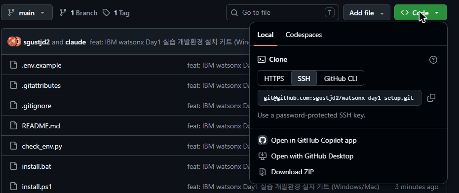
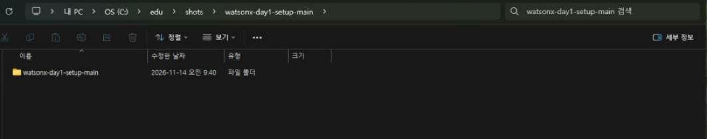
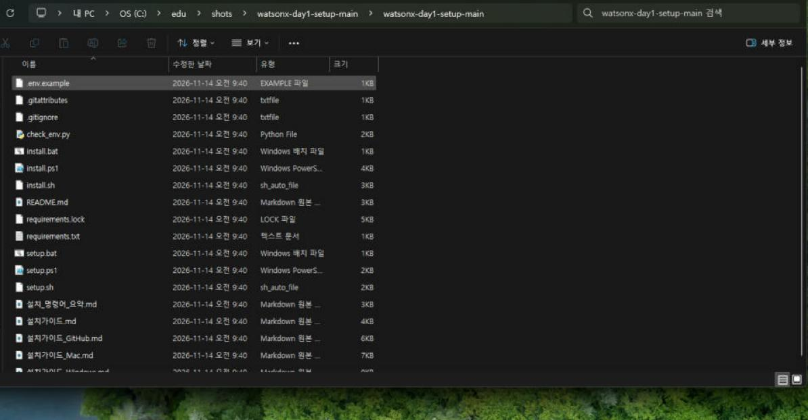
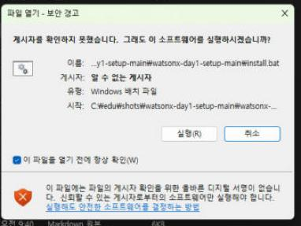
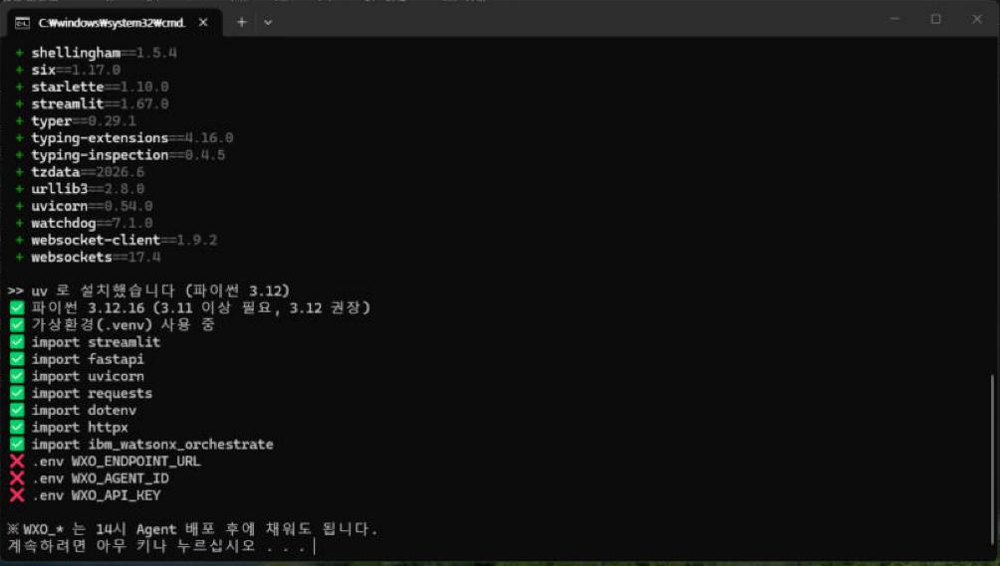
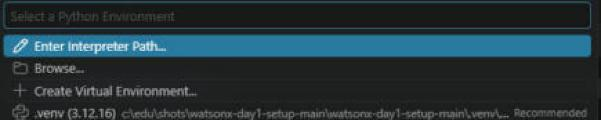
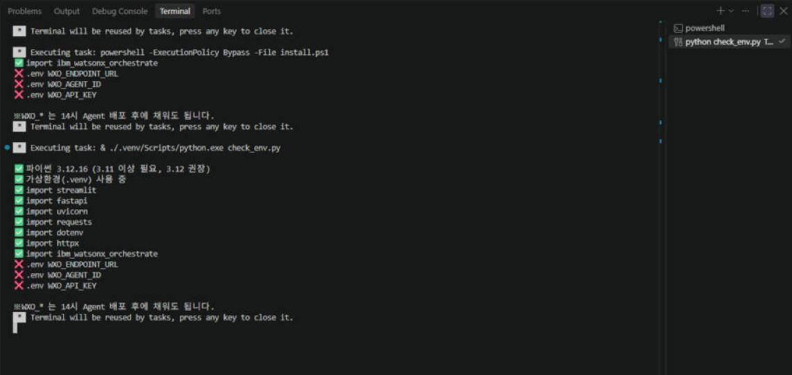
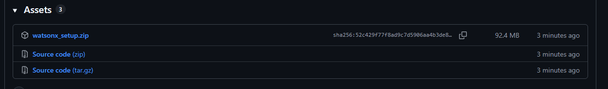

# IBM watsonx Day1 실습 — 개발환경 설치 키트 (Windows / Mac)

실습에 필요한 **파이썬 3.12 + 라이브러리**를 내 PC에 한 번에 만들어 주는 설치 키트입니다.
개발 경험이 없어도 따라 할 수 있게, 클릭할 곳과 입력할 명령, 정상일 때의 화면을 단계마다 적었습니다.

> **이 저장소에는 API 키·토큰·계정 정보가 없습니다.** 실습용 키 값은 강사가 따로 안내하며, 내 PC의 `.env` 파일에만 넣습니다. `.env`는 절대 공유·업로드하지 마세요.

## 0. 3줄 요약

1. 이 페이지 위쪽 초록색 **Code → Download ZIP** 으로 받아 `C:\edu`(Mac은 `~/edu`) 같은 **짧은 경로**에 풉니다.
2. **Windows:** 폴더의 `install.bat` 더블클릭 / **Mac:** 터미널에서 `bash install.sh`
3. 끝에 `✅` 가 줄줄이 나오면 성공입니다. (맨 아래 `.env` 항목의 `❌` 3개는 아직 키를 안 넣어서이므로 정상)

## 목차

1. [이 키트가 설치하는 것](#1-이-키트가-설치하는-것)
2. [저장소 구성 (용도별)](#2-저장소-구성-용도별)
3. [시작 전 준비물](#3-시작-전-준비물)
4. [Windows 설치 (자세히)](#4-windows-설치-자세히)
5. [Mac 설치 (자세히)](#5-mac-설치-자세히)
6. [설치 후 해야 할 일 (공통)](#6-설치-후-해야-할-일-공통)
7. [다른 설치 방법](#7-다른-설치-방법) — git clone · 오프라인 zip · github.com 이 막힌 경우
8. [문제 해결](#8-문제-해결)
9. [자주 묻는 질문](#9-자주-묻는-질문)
10. [설치 키트가 하는 일 (원리)](#10-설치-키트가-하는-일-원리)
11. [검증한 것 / 미확인](#11-검증한-것--미확인)

---

## 1. 이 키트가 설치하는 것

| 설치 대상 | 내용 | 위치 |
|---|---|---|
| 파이썬 3.12 | 키트가 `uv`로 받아서 **이 폴더의 `.venv` 안에서만** 사용합니다. 내 PC에 이미 있는 파이썬·conda는 건드리지 않습니다. | `.venv/` |
| 라이브러리 | `streamlit`(채팅 화면), `fastapi`·`uvicorn`(내 PC의 API), `requests`(Endpoint 호출), `python-dotenv`(`.env` 읽기), `httpx`(점검용), `ibm-watsonx-orchestrate`(Orchestrate CLI, ADK) | `.venv/` |
| 설정 파일 | `.env.example`을 복사해 만든 **빈 `.env`** (키 값은 직접 채움) | 이 폴더 |

- 라이브러리 버전은 `requirements.lock`에 **고정**되어 있어, 수업 전에 검증한 버전 그대로 설치됩니다.
- 다운로드는 약 **100MB**, 걸리는 시간은 **2~5분**(처음 한 번)입니다. 설치 후 `.venv` 폴더는 이보다 커집니다.
- 지우고 싶으면 이 폴더를 통째로 삭제하면 됩니다. (시스템 설정·PATH·레지스트리를 바꾸지 않습니다. 단, `uv`가 사용자 폴더에 설치되었을 수 있습니다 → [FAQ](#9-자주-묻는-질문))

## 2. 저장소 구성 (용도별)

```
watsonx-day1-setup/
├─ README.md                  ← 지금 보는 문서 (설치 방법 총정리)
│
├─ [인터넷 설치 — 기본]
│   ├─ install.bat            Windows: 더블클릭으로 설치
│   ├─ install.ps1            Windows: 실제 설치 스크립트 (PowerShell)
│   └─ install.sh             Mac: 설치 스크립트 (bash install.sh)
│
├─ [오프라인 설치 — 인터넷이 막힌 Windows PC용]
│   ├─ setup.bat / setup.ps1  Windows (Releases의 zip 안에서 사용)
│   └─ setup.sh               Mac (인터넷 설치로 동작, 오프라인 미지원)
│
├─ [설치 목록·설정]
│   ├─ requirements.txt       사람이 읽는 패키지 목록(출처 주석)
│   ├─ requirements.lock      검증한 버전을 고정한 목록 (실제 설치에 사용)
│   ├─ .env.example           환경변수 이름 예시 (값은 비어 있음)
│   └─ check_env.py           설치 점검 (✅/❌, 키 값은 출력하지 않음)
│
└─ docs/                      ← 문서 모음
    ├─ 00_전체_안내.md         문서 안내 / 10시 한 줄 요약
    ├─ 01_GitHub에서_받기.md   ZIP · git clone · 오프라인 zip 받는 법 (화면 포함)
    ├─ 02_Windows_설치.md      Windows 단계별 가이드
    ├─ 03_Mac_설치.md          Mac 단계별 가이드
    ├─ 04_명령어_요약.md       복사해서 쓰는 명령어 모음
    └─ images/                문서에 쓰인 실제 화면
```

> 설치 스크립트가 **같은 폴더의 `requirements.lock`, `check_env.py`, `.env.example`을 직접 읽기 때문에** 이 파일들은 폴더를 나누지 않고 맨 위에 둡니다. 문서만 `docs/`로 분리했습니다.

| 하고 싶은 일 | 보는 곳 |
|---|---|
| 처음 설치한다 | 이 README의 [4장(Windows)](#4-windows-설치-자세히) 또는 [5장(Mac)](#5-mac-설치-자세히) |
| 어떻게 받는지부터 모르겠다 | [docs/01_GitHub에서_받기.md](docs/01_GitHub에서_받기.md) |
| 인터넷이 막혀 있다 (Windows) | [7장 오프라인 zip](#72-오프라인-zip-windows-전용) |
| 에러가 났다 | [8장 문제 해결](#8-문제-해결) |
| 명령어만 빨리 보고 싶다 | [docs/04_명령어_요약.md](docs/04_명령어_요약.md) |

## 3. 시작 전 준비물

- [ ] **VS Code** 설치 + 확장 **Python**(Microsoft). 설치 방법: <https://code.visualstudio.com>
- [ ] **인터넷 연결** (설치 중 약 100MB 다운로드). 회사망이 막혀 있으면 [오프라인 zip](#72-오프라인-zip-windows-전용)
- [ ] **짧은 폴더 경로**: `C:\edu`(Windows) / `~/edu`(Mac). 다운로드 폴더나 OneDrive 안은 경로가 길어 설치가 실패할 수 있습니다(약 100자 이상). 실제로 약 120자 경로에서 설치가 실패하는 것을 확인했습니다.
- [ ] 파이썬·conda·git·GitHub 계정은 **필요 없습니다.** (내 PC에 이미 있어도 상관없습니다)
- [ ] 강사가 안내하는 **키 값**(`WXO_ENDPOINT_URL` 등)은 설치 후, 또는 14시 Agent 배포 후에 넣습니다.

---

## 4. Windows 설치 (자세히)

### 4-1. ZIP 받기

1. 이 저장소 페이지(<https://github.com/sgustjd2/watsonx-day1-setup>)에서 초록색 **Code** 버튼 → **Download ZIP**.
   파일 이름은 `watsonx-day1-setup-main.zip`(약 20KB)입니다.

   

### 4-2. 짧은 경로에 압축 풀기

1. 받은 ZIP을 `C:\edu` 폴더(없으면 새로 만들기)로 옮깁니다.
2. ZIP 파일을 **한 번 클릭**하면 파일 탐색기 위쪽에 **압축 풀기** 단추가 나타납니다. 누르고, 대화상자에서 다시 **압축 풀기**를 누릅니다. (ZIP 우클릭 → **모두 압축 풀기**도 같습니다.)
3. 같은 이름의 폴더가 **두 겹**으로 생기는 것이 정상입니다. **안쪽 폴더**(그 안에 `install.bat`이 보이는 폴더)가 실습 폴더입니다.

   
   

### 4-3. install.bat 실행

1. 안쪽 폴더에서 **`install.bat`을 더블클릭**합니다.
2. 인터넷에서 받은 파일이라 **"파일 열기 - 보안 경고"(게시자를 확인하지 못했습니다)** 창이 뜨면 **실행**을 누릅니다.
   - 이 창이 계속 막으면: ZIP 파일 우클릭 → **속성** → 아래쪽 **차단 해제** 체크 → 확인 → 다시 압축 풀기. 이미 풀었다면 PowerShell에서 `Get-ChildItem C:\edu -Recurse | Unblock-File`
   - 파란색 **"Windows의 PC 보호"(SmartScreen)** 창이 뜨면 **추가 정보 → 실행**입니다. (이 창은 테스트 PC에서 나타나지 않아 직접 확인하지 못했습니다)

   

3. 검은 창이 열리고 설치가 진행됩니다(2~5분). **창을 닫지 말고 기다리세요.** 설치되는 패키지 목록이 올라갑니다.
4. 끝나면 `>> uv 로 설치했습니다 (파이썬 3.12)`와 함께 점검 결과가 나오고, 맨 아래 **"계속하려면 아무 키나 누르십시오"** 에서 아무 키나 누르면 창이 닫힙니다.

   

   - `✅ 파이썬 3.12.x`, `✅ 가상환경(.venv)`, `✅ import ...` 줄이 모두 ✅ 이면 성공입니다.
   - `❌ .env WXO_ENDPOINT_URL / WXO_AGENT_ID / WXO_API_KEY` 3줄은 아직 값을 넣지 않아서이며 **정상**입니다.

> `install.bat`이 더블클릭에 반응이 없거나 창이 바로 닫히면: VS Code로 이 폴더를 열고 터미널(`Terminal > New Terminal`)에서
> `powershell -ExecutionPolicy Bypass -File install.ps1` 을 실행하면 오류 메시지를 볼 수 있습니다.

### 4-4. VS Code로 폴더 열기

1. VS Code → **File > Open Folder**(한국어: 파일 > 폴더 열기) → **안쪽 폴더** 선택.
2. 위쪽에 **Restricted Mode** 배너가 뜨면 **Manage** → **Trust**(Trust Folder & Continue)를 누릅니다.
3. 왼쪽 목록에 `install.bat`, `requirements.lock`, `.env` 등이 보이면 맞습니다.

### 4-5. `.env` 채우기

1. VS Code 왼쪽 목록에서 `.env`를 엽니다(설치가 만들어 둡니다. 없으면 `.env.example`을 복사해 이름을 `.env`로 바꿉니다).
2. 강사가 알려 준 값을 `=` 뒤에 붙여넣고 저장(`Ctrl+S`)합니다.

   ```
   WXO_ENDPOINT_URL=
   WXO_AGENT_ID=
   WXO_API_KEY=
   ```

   - `WXO_*`는 14시 Agent 배포 후에 채워도 됩니다.
   - 값을 캡처·채팅·문서에 올리지 마세요.

### 4-6. VS Code에 `.venv` 연결

1. `.py` 파일(예: `check_env.py`)을 열고, 오른쪽 아래 상태 표시줄의 파이썬 버전을 누릅니다. (또는 `Ctrl+Shift+P` → **Python: Select Interpreter**)
2. 목록에서 **`.venv (3.12.x)`** 항목(Recommended)을 선택합니다. 없으면 **Enter Interpreter Path...** → `.venv\Scripts\python.exe`

   

3. 새 터미널(`Terminal > New Terminal`) 앞에 `(.venv)`가 보이면 연결된 것입니다.

### 4-7. 점검

VS Code 터미널에서:

```powershell
python check_env.py
```

기대 결과(`.env`를 채우기 전):

```
✅ 파이썬 3.12.x (3.11 이상 필요, 3.12 권장)
✅ 가상환경(.venv) 사용 중
✅ import streamlit
✅ import fastapi
✅ import uvicorn
✅ import requests
✅ import dotenv
✅ import httpx
✅ import ibm_watsonx_orchestrate
❌ .env WXO_ENDPOINT_URL
❌ .env WXO_AGENT_ID
❌ .env WXO_API_KEY
```



---

## 5. Mac 설치 (자세히)

> 이 장은 실제 Mac에서는 실행해 보지 못했습니다. 같은 스크립트를 Linux에서 실행해 확인했습니다. (자세한 범위는 [11장](#11-검증한-것--미확인))

### 5-1. ZIP 받아 풀기

1. 저장소 페이지에서 **Code → Download ZIP**.
2. 홈 폴더에 `edu` 폴더를 만들고(`~/edu`) ZIP을 옮겨 더블클릭으로 풉니다. 같은 이름 폴더가 두 겹이면 **안쪽 폴더**(그 안에 `install.sh`가 보이는 폴더)가 실습 폴더입니다.

### 5-2. VS Code로 열고 터미널 열기

1. VS Code → **File > Open Folder** → 실습 폴더. Restricted Mode 배너가 뜨면 **Manage → Trust**.
2. **Terminal > New Terminal**. 터미널이 열린 폴더가 실습 폴더인지 확인합니다.

### 5-3. 설치

```bash
bash install.sh
```

- `./install.sh`처럼 실행하면 `permission denied`가 날 수 있습니다. **반드시 `bash install.sh`** 로 실행하세요.
- 2~5분 걸리고, 끝에 `✅ import ...` 줄들이 나오면 성공입니다.
- 컴파일 오류가 나면 터미널에서 `xcode-select --install`을 실행한 뒤 다시 시도합니다.

### 5-4. `.env`, 인터프리터, 점검

- `.env`: 폴더의 `.env`를 VS Code에서 열어 키 값을 채웁니다(Finder에서는 `.`으로 시작하는 파일이 숨겨지므로 VS Code 목록에서 찾습니다).
- 인터프리터: `Cmd+Shift+P` → **Python: Select Interpreter** → `.venv` (없으면 **Enter Interpreter Path...** → `.venv/bin/python`)
- 점검: 터미널에서 `python check_env.py` (`python`이 없다고 나오면 `.venv/bin/python check_env.py`)

---

## 6. 설치 후 해야 할 일 (공통)

### 6-1. 예제 실행

예제 폴더(예: 예제11)에서 실행합니다. **`streamlit run` 이 아니라 `python -m streamlit run`** 으로 씁니다. (일부 PC에서 `streamlit.exe` 실행이 보안 정책에 막힙니다.)

키 없이 먼저 화면만 보려면 `MOCK`을 켭니다.

| | Windows (PowerShell) | Mac (터미널) |
|---|---|---|
| MOCK 켜기 | `$env:MOCK = "1"` | `export MOCK=1` |
| 화면 실행 | `python -m streamlit run app.py` | `python -m streamlit run app.py` |
| API 실행 | `python -m uvicorn app:api --reload` | `python -m uvicorn app:api --reload` |

- 화면: <http://localhost:8501> / API 문서: <http://127.0.0.1:8000/docs>
- 화면과 API를 동시에 켤 필요는 없습니다.

### 6-2. 다시 설치하거나 업데이트할 때

- `install.bat`(또는 `install.sh`)을 **다시 실행**하면 `.venv`를 지우고 새로 만듭니다. (`.env`는 그대로 둡니다)
- VS Code가 `.venv`를 쓰는 중이면 삭제가 실패할 수 있으니 터미널을 모두 닫고 다시 실행하세요.
- 키트가 업데이트되면 `git pull`(git으로 받은 경우) 또는 ZIP을 새로 받아 **새 폴더**에 푸세요.

---

## 7. 다른 설치 방법

### 7-1. git clone (git이 이미 있는 경우)

```
git --version
```

버전이 나오면:

```powershell
# Windows (PowerShell)
git clone https://github.com/sgustjd2/watsonx-day1-setup.git C:\edu\watsonx-day1-setup
cd C:\edu\watsonx-day1-setup
```

```bash
# Mac (터미널)
mkdir -p ~/edu && git clone https://github.com/sgustjd2/watsonx-day1-setup.git ~/edu/watsonx-day1-setup
cd ~/edu/watsonx-day1-setup
```

그 폴더에서 4-3(Windows) 또는 5-3(Mac)부터 이어서 합니다. **git이 없다면 설치하지 말고 ZIP 방법**을 쓰세요.

### 7-2. 오프라인 zip (Windows 전용)

회사망이 설치 중 다운로드(uv/pip)를 막는 **Windows** PC에서 씁니다.

1. [Releases](https://github.com/sgustjd2/watsonx-day1-setup/releases/tag/v1)의 **Assets**에서 `watsonx_setup.zip`(약 92MB)을 받습니다.

   

2. `C:\edu` 같은 짧은 경로에 풀고, 폴더의 **`setup.bat`을 더블클릭**합니다.
3. 이 zip에는 설치 스크립트와 라이브러리 패키지(`wheelhouse-win`)가 함께 들어 있어 인터넷 없이 설치됩니다.
4. 이후 `.env`, 인터프리터, 점검은 4-5 ~ 4-7과 같습니다.

> **Mac은 오프라인 설치를 지원하지 않습니다.** Mac은 ZIP으로 받아 `bash install.sh`(인터넷 필요)를 쓰세요.
> 파이썬 버전이 zip의 패키지 묶음(3.12)과 다르면 `setup.bat`이 자동으로 인터넷 설치로 넘어갑니다.

### 7-3. github.com 자체가 막힌 경우

강사가 가진 USB 또는 공유 폴더(Drive)에 같은 파일이 있으면 그것을 받아 사용하세요. 이 저장소가 안내할 수 있는 범위는 거기까지입니다.

---

## 8. 문제 해결

| 증상 | 원인 | 해결 |
|---|---|---|
| `install.bat` 더블클릭 시 "파일 열기 - 보안 경고" | 인터넷에서 받은 파일이라는 표시 | **실행**을 누릅니다. 계속 막히면 ZIP **속성 → 차단 해제** 후 다시 풀기 |
| 파란 "Windows의 PC 보호" 창 | SmartScreen | **추가 정보 → 실행** (미확인) |
| 압축을 풀었더니 폴더 안에 폴더가 또 있음 | 정상 | `install.bat`이 보이는 **안쪽 폴더**를 사용 |
| `install.bat`을 열어도 창이 바로 닫힘 | 실행 정책·경로 문제 등 | VS Code 터미널에서 `powershell -ExecutionPolicy Bypass -File install.ps1` 실행 후 메시지 확인 |
| `스크립트를 실행할 수 없습니다` (실행 정책) | PowerShell 실행 정책 | `-ExecutionPolicy Bypass`를 붙여 실행 (`install.bat`은 이미 붙어 있음) |
| 설치 중 `OSError ... No such file or directory` + 긴 경로 | Windows 경로 길이 제한(약 260자) | 폴더 경로를 짧게(`C:\edu`) 해서 다시 풀기. 스크립트가 경로가 100자를 넘으면 경고를 출력합니다 |
| 화면에 `>> uv 를 쓸 수 없어(회사망 차단 등) PC 에 있는 파이썬으로 설치합니다` | uv 다운로드(astral.sh) 차단 | 정상 동작입니다. PC에 파이썬 3.11/3.12가 있으면 그것으로 자동 설치합니다 |
| `사용할 수 있는 파이썬 3.12/3.11 이 없습니다. python.org 에서 3.12 설치 후 다시 실행하세요.` | uv도 막혔고 PC에 쓸 파이썬도 없음 | <https://www.python.org>에서 3.12 설치(**Add python.exe to PATH 체크**) 후 다시 실행. 또는 [오프라인 zip](#72-오프라인-zip-windows-전용) |
| `>> requirements.lock 으로 설치하지 못해 requirements.txt 로 설치합니다` | 고정 버전을 이 PC에서 설치할 수 없음 | 자동으로 최신 호환 버전으로 설치합니다. 동작에는 보통 문제가 없습니다 |
| `Failed to create virtual environment` | VS Code/터미널이 `.venv`를 쓰는 중 | VS Code와 터미널을 모두 닫고 폴더 탐색기에서 `install.bat` 다시 실행 |
| `streamlit.exe`가 "애플리케이션 제어 정책"에 막힘 | 회사 보안 정책 | `python -m streamlit run app.py` (그리고 `python -m uvicorn app:api`) |
| `ModuleNotFoundError` / `No module named streamlit` | 터미널의 `python`이 `.venv`가 아님 (conda `(base)` 등) | 인터프리터를 `.venv`로 선택하고 새 터미널을 엽니다. 급하면 `.venv\Scripts\python.exe -m streamlit run app.py` (Mac: `.venv/bin/python ...`) |
| 터미널 앞에 `(base)`가 보임 | conda 자동 활성화 | `conda deactivate` 후 새 터미널 |
| `check_env.py`에서 `❌ 가상환경(.venv) 사용 중` | 인터프리터가 `.venv`가 아님 | 4-6 인터프리터 선택 |
| 폴더를 열었는데 터미널이 안 열림 | Restricted Mode | 배너의 **Manage → Trust** |
| Mac: `./install.sh` → `permission denied` | 실행 권한 | `bash install.sh` |
| Mac: 컴파일 오류 | Xcode 명령줄 도구 없음 | `xcode-select --install` 후 다시 실행 |
| `git clone`에서 SSL / 프록시 오류 | 회사망 설정 | ZIP으로 받기(7장 참고) 또는 강사 문의 |
| pip 타임아웃 / 프록시·SSL 오류 | 회사망 | 강사에게 사내 설정 문의, 오프라인 zip(Windows) |

그래도 해결되지 않으면 **화면을 캡처**해서 강사에게 보내 주세요. (이름·이메일·키 값이 보이면 가리고 보내세요.)

## 9. 자주 묻는 질문

**Q. 내 PC에 이미 파이썬/conda가 깔려 있는데 괜찮나요?**
네. 설치 스크립트는 PATH의 파이썬을 쓰지 않고 `uv`가 받은 3.12만 `.venv`에 씁니다. conda(파이썬 3.14), uv로 설치한 3.13, Microsoft Store 파이썬 별칭이 PATH 앞에 있고 `PYTHONPATH`·`PYTHONHOME`이 엉뚱하게 설정된 상태에서도 `.venv`가 3.12로 만들어지는 것을 Windows에서 확인했습니다. 단, 설치 후 터미널의 `python`이 `.venv`가 아닐 수 있으니 4-6(인터프리터 선택)을 꼭 하세요.

**Q. 파이썬 3.13 이상이 깔려 있습니다.**
설치에는 영향이 없습니다(키트가 3.12를 따로 받습니다). 3.13을 직접 `pip install`로 쓰면 일부 패키지 설치가 실패할 수 있으니 이 키트의 `.venv`를 쓰세요.

**Q. 다시 설치하면 `.env`가 지워지나요?**
아니요. 다시 실행하면 `.venv`만 지우고 새로 만듭니다. `.env`가 이미 있으면 그대로 둡니다.

**Q. 어떻게 지우나요?**
실습 폴더를 통째로 삭제하면 됩니다. 시스템 설정은 바꾸지 않습니다. 설치 중 `uv`가 없던 PC에는 사용자 폴더(`%USERPROFILE%\.local\bin` / `~/.local/bin`)에 uv 실행 파일이 설치되었을 수 있고, 필요 없으면 그 파일들을 지워도 됩니다.

**Q. 회사 PC에서 외부 스크립트 실행이 걱정됩니다.**
`install.ps1`/`install.sh`는 uv가 없으면 uv 공식 설치 스크립트(`https://astral.sh/uv/install.ps1` / `install.sh`)를 내려받아 실행합니다. 이게 어렵다면 PC에 파이썬 3.12를 직접 설치해 두면 설치 스크립트가 그 파이썬으로 자동 대체합니다. 스크립트는 모두 이 저장소에서 읽어 볼 수 있습니다.

**Q. 키(API 키)는 어디에 넣나요?**
내 PC의 `.env` 파일에만 넣습니다. 이 저장소·화면 캡처·메신저에는 올리지 마세요. `.gitignore`에 `.env`가 들어 있어 git으로 실수로 올라가지 않습니다.

## 10. 설치 키트가 하는 일 (원리)

`install.bat` → `install.ps1`(Windows) / `install.sh`(Mac)이 다음 순서로 동작합니다.

1. `PYTHONPATH`·`PYTHONHOME` 환경변수를 비웁니다(다른 파이썬 설정이 `.venv`를 오염시키지 않게).
2. **uv 경로(1순위):** `uv`가 없으면 설치한 뒤, `uv venv .venv --python 3.12 --managed-python --clear --force`로 3.12 가상환경을 만들고 `uv pip install -r requirements.lock`으로 라이브러리를 설치합니다. lock으로 설치할 수 없으면 `requirements.txt`로 대체하고 화면에 알려 줍니다.
3. **PC 파이썬 경로(2순위):** uv를 못 쓰면 PC에 이미 있는 3.12/3.11(`py -3.12`, `py -3.11`, `python`, `python3` 순)로 `.venv`를 만들고 `pip install -r requirements.lock`을 실행합니다. 쓸 파이썬이 없으면 안내 메시지를 내고 멈춥니다. (Microsoft Store 별칭은 인정하지 않습니다)
4. `.env`가 없으면 `.env.example`을 복사합니다.
5. `check_env.py`로 점검합니다.

`setup.bat`/`setup.ps1`/`setup.sh`는 같은 일을 **패키지 묶음(wheelhouse)** 으로 먼저 시도합니다(Releases의 zip에 들어 있음). wheelhouse가 없거나 맞지 않으면 인터넷 설치로 넘어갑니다.

## 11. 검증한 것 / 미확인

**실제로 실행해 확인함 (Windows 11, 파이썬 3.12)**
- 새로 받은 저장소 ZIP을 풀어 `install.ps1` 실행 → 설치 완료, `check_env.py` ✅ 9개(`.env`의 `WXO_*` ❌ 3개는 예상), 설치 버전이 `requirements.lock`과 전부 일치
- `git clone` → `install.ps1`, `git pull`
- 인터넷 표시가 붙은 ZIP을 탐색기로 풀고 `install.bat` 더블클릭 → 보안 경고 → 설치 완료 → VS Code 열기·Trust·인터프리터 선택
- conda 3.14 / uv 3.13 / Store 별칭 / 엉터리 `PYTHONPATH`·`PYTHONHOME` 환경에서 `.venv`가 3.12로 만들어짐
- uv 차단 상황(uv 없음 + 다운로드 실패) → PC 파이썬으로 자동 설치, 쓸 파이썬이 없으면 안내 메시지
- Releases zip을 풀어 PyPI 접근을 막은 채 `setup.bat` 오프라인 설치 → lock과 버전 일치
- 같은 스크립트를 Linux(WSL)에서 실행: `install.sh` 정상 설치

**미확인**
- 실제 macOS (Apple Silicon/Intel)에서의 `install.sh`
- 파란 SmartScreen 창, 잠긴 회사 PC(서명 없는 실행 파일 차단 등)
- VS Code 한국어 메뉴 이름
- Mac의 오프라인 설치(지원하지 않음)
