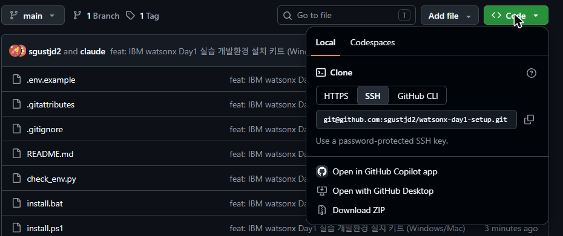
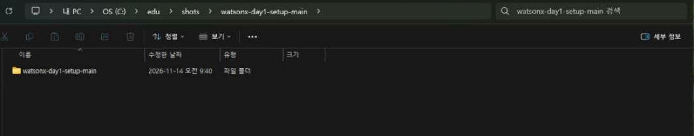
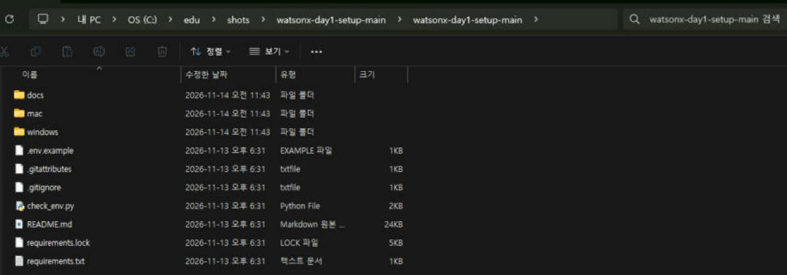
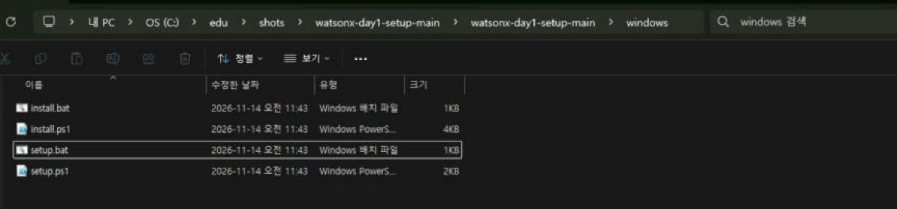
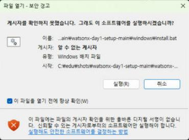

# 개발환경 세팅 — GitHub로 받기

설치 키트(스크립트 + 가이드)는 GitHub에 올라 있습니다. **계정도 git도 필요 없습니다.** 가장 쉬운 방법 A(ZIP)를 기본으로 쓰세요.

- 저장소: https://github.com/sgustjd2/watsonx-day1-setup
- 오프라인 zip(Windows 전용): https://github.com/sgustjd2/watsonx-day1-setup/releases/tag/v1

> 검증 범위: 방법 A(새로 받은 ZIP)와 방법 B(git clone)는 Windows 11에서 실제로 실행해 설치까지 확인했습니다. Mac, 윈도우 SmartScreen 화면은 **미확인**입니다.

## 어떤 방법을 쓸까

| 상황 | 방법 |
|---|---|
| 대부분 (git 없음, GitHub 계정 없음) | **방법 A — Download ZIP** |
| 이미 git을 쓰고 있음 | 방법 B — git clone (git을 이 때문에 따로 설치할 필요는 없습니다) |
| 회사망이 설치 중 다운로드(uv/pip)를 막음 (Windows) | 오프라인 zip (Releases) |
| github.com 자체가 막힘 | 강사의 USB/Drive 복사본 |

## 방법 A — Download ZIP (기본)

1. 저장소 페이지를 엽니다: https://github.com/sgustjd2/watsonx-day1-setup
2. 초록색 **Code** 버튼 → **Download ZIP**. (`watsonx-day1-setup-main.zip`, 약 0.3MB)


3. **짧은 경로**에 압축을 풉니다. Windows는 `C:\edu`, Mac은 홈 폴더의 `edu`(`~/edu`)를 권합니다. 다운로드 폴더나 OneDrive 안은 경로가 길어 설치가 실패할 수 있습니다(약 100자 이상).
   - Windows: ZIP 파일을 한 번 클릭하면 위쪽 도구 모음에 **압축 풀기**가 나타납니다(우클릭 → **모두 압축 풀기** 도 같습니다). 대화상자에서 **압축 풀기**를 누릅니다. 별도 프로그램은 필요 없습니다.
   - 이때 `watsonx-day1-setup-main` 폴더가 **두 겹**으로 생기는 것이 정상입니다(실제 화면에서 확인). **그 안에 `windows` 폴더와 `mac` 폴더가 보이는 안쪽 폴더**가 실습 폴더입니다.

   
   
   
4. (Windows) 인터넷에서 받은 파일 경고: ZIP을 우클릭 → **속성** → 아래쪽 **차단 해제** 체크 → 확인한 뒤 압축을 풀면 경고가 줄어듭니다. 이미 풀었다면 PowerShell에서
   ```powershell
   Get-ChildItem C:\edu -Recurse | Unblock-File
   ```
   `windows` 폴더의 `install.bat`을 더블클릭하면 인터넷에서 받은 파일이라 **파일 열기 - 보안 경고**('게시자를 확인하지 못했습니다')가 뜹니다. **실행**을 누르면 됩니다(실제 화면에서 확인). 파란 **Windows의 PC 보호(SmartScreen)** 창은 이 PC에서 나타나지 않았고, 뜨는 PC에서는 **추가 정보 → 실행**입니다(미확인).

   
5. VS Code로 실습 폴더를 엽니다(`File > Open Folder`).
6. 설치:
   - **Windows:** `windows` 폴더의 `install.bat` 더블클릭 (또는 VS Code 터미널에 `powershell -ExecutionPolicy Bypass -File windows\install.ps1`)
   - **Mac:** VS Code 터미널에 `bash mac/install.sh`
7. 이후 `.env` 채우기 → `.venv` 인터프리터 선택 → 점검은 OS별 가이드를 따릅니다: `02_Windows_설치.md` / `03_Mac_설치.md`

## 방법 B — git clone (git이 이미 있을 때)

git이 있는지 확인합니다.
```
git --version
```
버전이 나오면 아래를 입력합니다. **git이 없다면 설치하지 말고 방법 A를 쓰세요.**

Windows (PowerShell):
```powershell
git clone https://github.com/sgustjd2/watsonx-day1-setup.git C:\edu\watsonx-day1-setup
cd C:\edu\watsonx-day1-setup
```
Mac (터미널):
```bash
mkdir -p ~/edu && git clone https://github.com/sgustjd2/watsonx-day1-setup.git ~/edu/watsonx-day1-setup
cd ~/edu/watsonx-day1-setup
```
그 폴더를 VS Code로 열고 방법 A의 6단계부터 이어서 합니다.

나중에 키트가 업데이트되면 폴더 안에서 `git pull` 하거나, ZIP을 다시 받아 새 폴더에 푸세요.

## 오프라인 zip (Windows 전용)

uv/pip 다운로드가 막힌 Windows PC에서 씁니다. Releases 페이지(https://github.com/sgustjd2/watsonx-day1-setup/releases/tag/v1)의 **Assets** 에서 `watsonx_setup.zip`(약 97MB (GitHub 화면에는 92.6MB로 표시될 수 있음))을 받습니다.

- 설치 스크립트와 라이브러리 패키지(`wheelhouse-win`, 버전은 `requirements.lock`에 고정)가 함께 들어 있어 인터넷 없이 설치됩니다.
- 짧은 경로(`C:\edu`)에 풀고, `windows` 폴더의 `setup.bat`을 더블클릭합니다.
- **Windows 전용**입니다. Mac은 오프라인 설치를 지원하지 않으며, 방법 A로 받아 `bash mac/install.sh`(인터넷 필요)를 씁니다.

## github.com이 막혀 있다면

강사가 가진 USB 또는 공유 폴더(Drive)에 같은 파일들이 있으면 그것을 받아 사용합니다. 강사가 준비해 둔 것 이상은 안내하지 못합니다.

## 자주 나는 에러

| 증상 | 해결 |
|---|---|
| `git`을 찾을 수 없음 / 'git'은 명령이 아님 | git을 설치할 필요 없이 **방법 A(Download ZIP)** 를 쓰세요. |
| ZIP을 풀었더니 폴더 안에 폴더가 또 있음 | `windows` 폴더(Mac은 `mac` 폴더)가 들어 있는 **안쪽 폴더**를 VS Code로 여세요. |
| 설치 중 `OSError ... No such file or directory`, 긴 경로 | 폴더 경로가 길 때(약 100자 이상) 생깁니다. `C:\edu` 같은 짧은 경로에 다시 푸세요. |
| `git clone`에서 SSL / 프록시 오류(`SSL certificate problem`, `Failed to connect`) | 회사망 설정 문제입니다. 방법 A(ZIP)로 받거나 강사에게 문의하세요. |
| SmartScreen / Defender가 `windows\install.bat`을 막음 | 위 A-4단계(차단 해제, 추가 정보 → 실행). 그래도 막히면 강사에게 문의하세요. |
| Mac에서 `./install.sh` → `permission denied` | 실행 권한이 없는 것이라 정상입니다. **`bash mac/install.sh`** 로 실행하세요. |
| `windows\install.bat`을 더블클릭해도 창이 바로 닫힘 | VS Code 터미널에서 `powershell -ExecutionPolicy Bypass -File windows\install.ps1`로 실행해 오류 메시지를 확인하세요. |

## 확인한 것 / 미확인

- 확인(Windows 11, 위 화면은 실제 실행 화면): 새로 받은 ZIP 풀기 → `windows\install.ps1`, `git clone` → `windows\install.ps1` 모두 설치와 `check_env.py`(✅ 9개, `.env`의 `WXO_*` ❌ 3개는 예상)까지 통과. `git pull`은 "Already up to date".
- 미확인: Mac 전 과정, 윈도우 SmartScreen/Defender 화면, 잠긴 회사 PC, `Unblock-File` 이후의 경고 변화.
